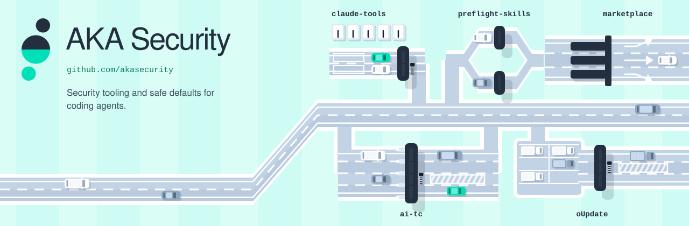
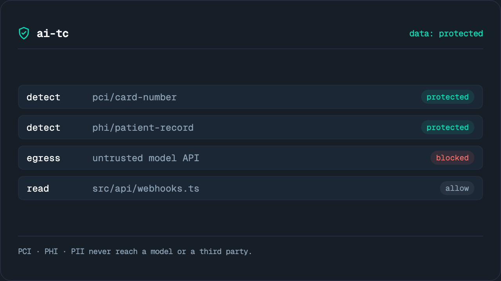

<picture>
  <source media="(prefers-color-scheme: dark)" srcset="assets/cover-dark.svg">
  
</picture>

<p align="center">
  <a href="#projects"><b>Projects</b></a> &nbsp;·&nbsp;
  <a href="#install"><b>Install</b></a> &nbsp;·&nbsp;
  <a href="https://akasecurity.io"><b>akasecurity.io</b></a>
</p>

<h3 align="center">Security tooling and safe defaults for coding agents.</h3>

Sensitive-data detection and protection for every tool call, MCP server, and RAG pipeline.


[](https://akasecurity.io)

<p>
  
</p>

## Projects

| Project | What it is |
|---|---|
| **[AI Traffic Control](https://github.com/akasecurity/ai-tc)** (`ai-tc`) | Guardrails for the agent harness: regulated data stays on your machine, and every prompt and tool call is scanned before it runs.   |
| **[claude-tools](https://github.com/akasecurity/claude-tools)** (`aka-claude-tools`) | The security defaults Claude Code doesn't ship with: clean context, locked-down credentials, guarded egress, layered onto an isolated profile.  |
| **[preflight-skills](https://github.com/akasecurity/preflight-skills)** (`preflight`) | A second opinion before you merge: an independent multi-model review crew for coding agents. Report-only, cross-family. Also ships `secure-research`, cited web research spread across several search engines.  |
| **[oupdate](https://github.com/akasecurity/oupdate)** | Recurring, gated dependency updates for a fleet of hosts: supply-chain review before anything is applied. |
| **[marketplace](https://github.com/akasecurity/marketplace)** | One place to install every AKA Security tool, across Claude Code, Codex, and more. |

## Install

Claude Code and Codex install from one marketplace — **[akasecurity/marketplace](https://github.com/akasecurity/marketplace)**:

```bash
# Claude Code
/plugin marketplace add akasecurity/marketplace
/plugin install preflight@akasecurity
/plugin install aka-claude-tools@akasecurity
/plugin install ai-tc@akasecurity

# Codex
codex plugin marketplace add akasecurity/marketplace
codex plugin add preflight@akasecurity

# Antigravity — direct repo install (no marketplace mechanism)
agy plugin install https://github.com/akasecurity/preflight-skills
```

Standalone CLI, no coding agent: `brew install akasecurity/tap/<tool>` via the [Homebrew tap](https://github.com/akasecurity/homebrew-tap).

Each project is licensed in its own repository · <https://akasecurity.io>
